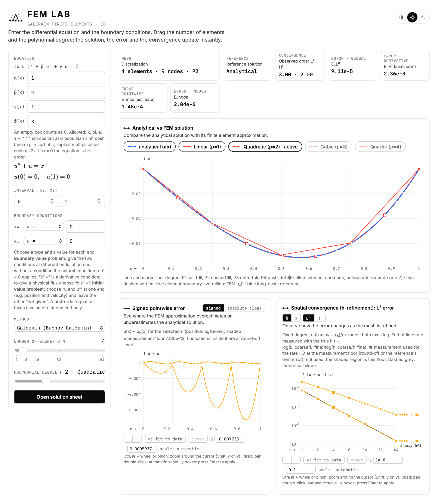
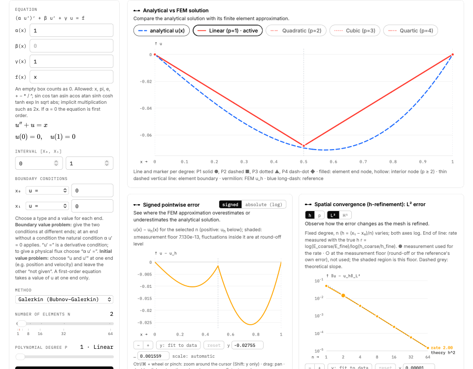
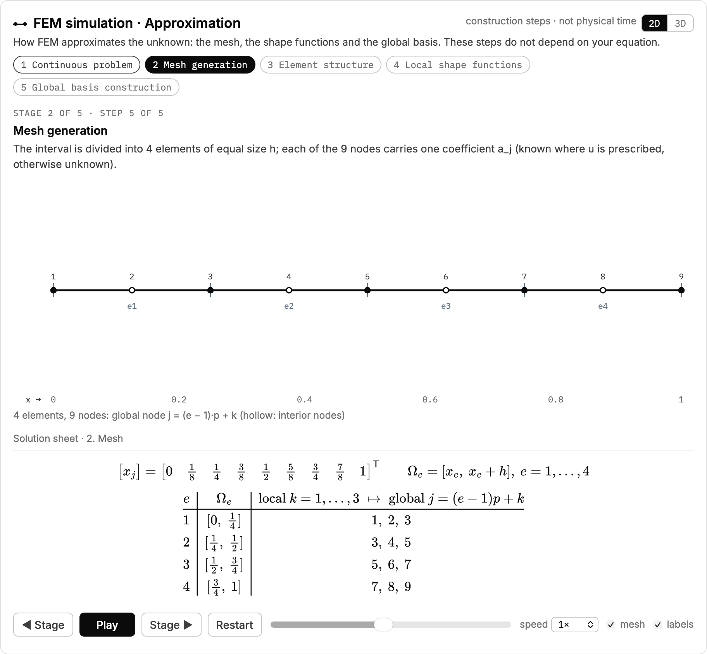
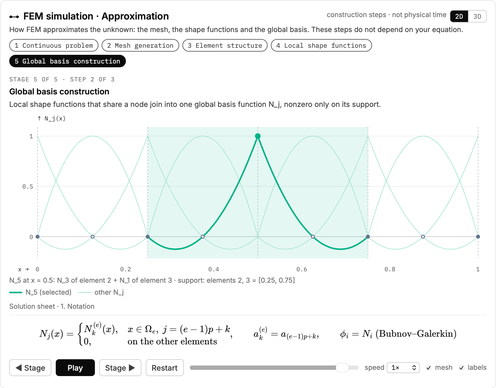
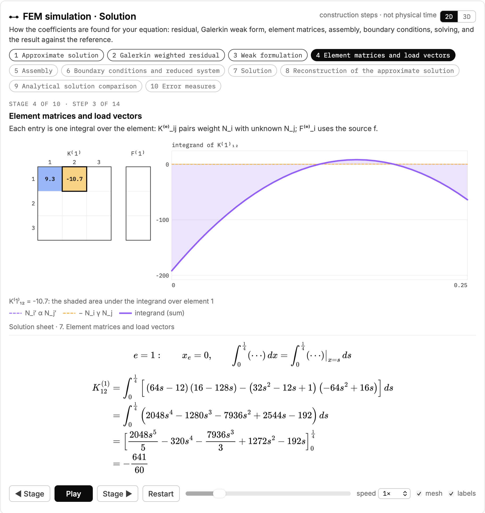
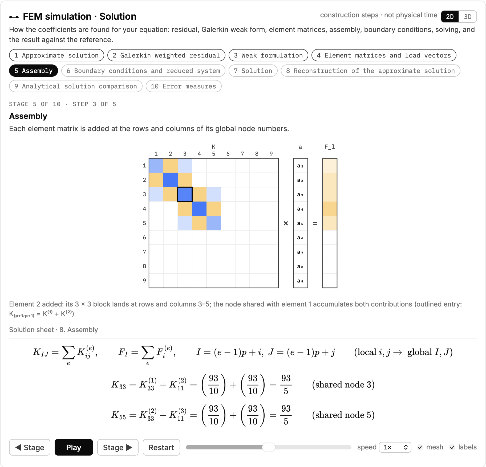
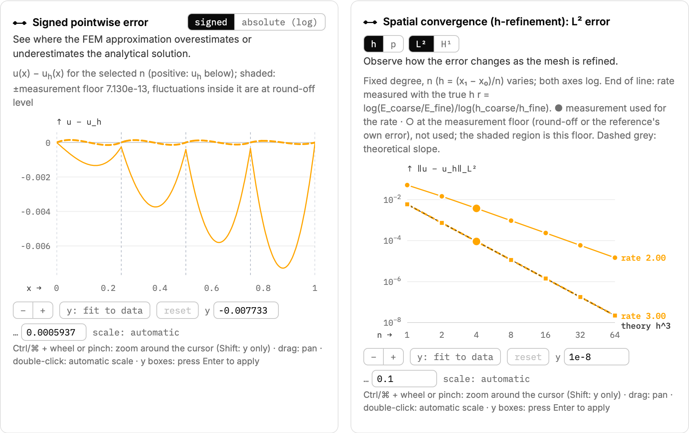
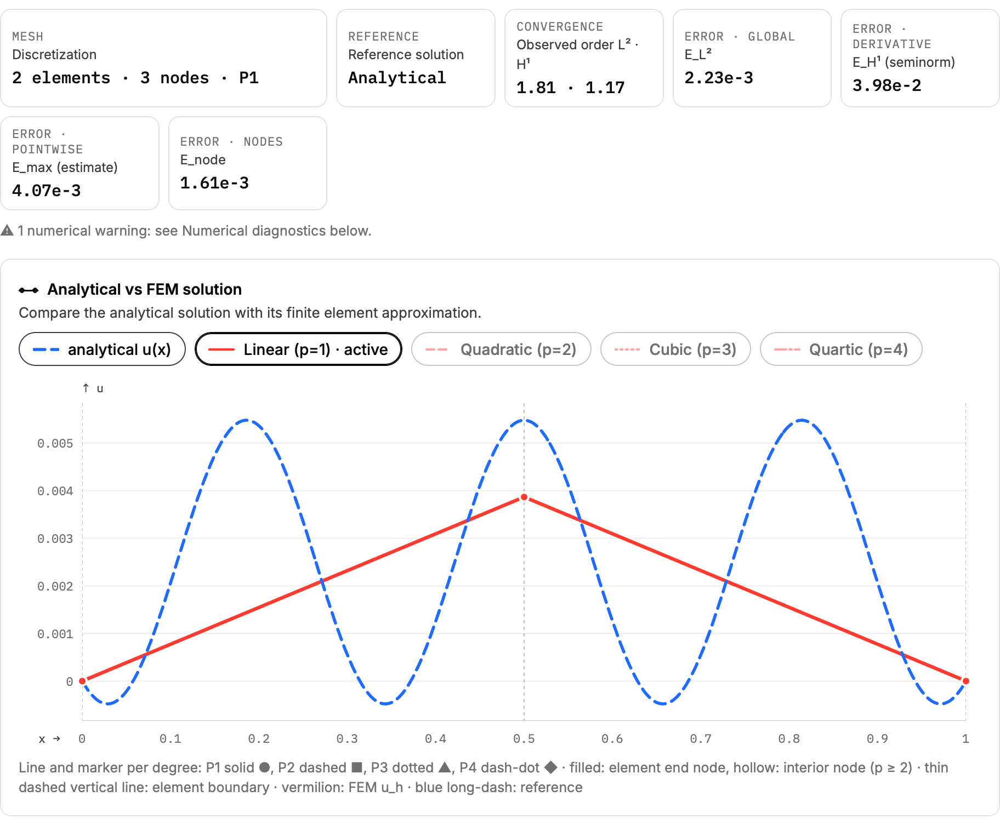
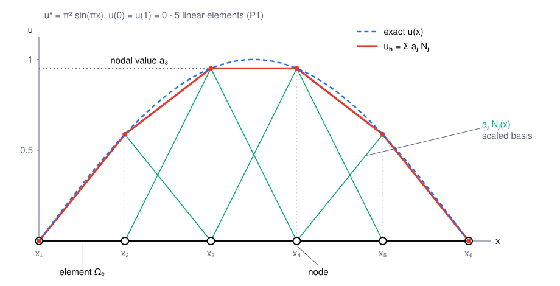
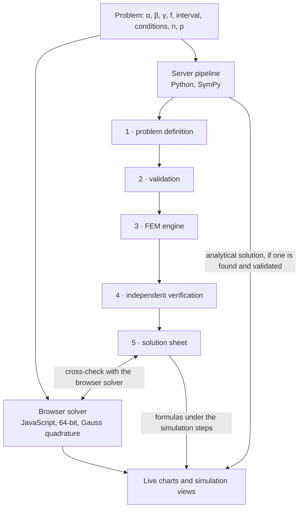

# FEM LAB

**Interactive one-dimensional finite elements: see how a differential equation becomes a linear system, solve it, and
check the result.**

[](https://github.com/yzd-info/fem-lab/actions/workflows/ci.yml)
[](LICENSE)

You type a linear 1D differential equation and its boundary conditions. FEM LAB solves it with the Galerkin finite
element method (Lagrange elements P1–P4), draws the solution, the error and the convergence while you move the sliders,
walks through the construction step by step, and writes the full mathematical solution sheet.

Open source · runs on your machine · no framework, no build step

<picture>
  <source media="(prefers-color-scheme: dark)" srcset="docs/img/hero-dark.png">
  
</picture>

**Changing the mesh and the degree.** $n = 2, 3, 4, 6, 8$ with linear elements, a return to $n = 4$, then $p = 2$ and
$p = 3$ (frames captured from the running application):



---

## Contents

[Purpose](#purpose) · [What you can explore](#what-you-can-explore) · [Learning objectives](#learning-objectives) ·
[Visual walkthrough](#visual-walkthrough) · [How the mathematics is built](#how-the-mathematics-is-built) ·
[How it works](#how-it-works) · [Supported problems](#supported-problems) · [Quick start](#quick-start) ·
[Worked example](#worked-example) · [Verification](#verification) · [Limitations](#limitations) ·
[Architecture](#architecture) · [Documentation](#documentation) · [Citation](#citing-fem-lab) · [License](#license)

## Purpose

A solver that returns only numbers hides the road to them. When you are learning the finite element method, the road is
the subject: why the equation is multiplied by a weighting function, where the boundary term comes from, how an
integral becomes one matrix entry, what assembly does, and how far the result is from the truth.

FEM LAB is built to keep that road visible:

- **The numbers are traceable.** The solution sheet follows element integrals from the substituted shape functions to
  their values, then the assembly, the reduced system and the reconstructed solution (long sheets abbreviate repeated
  elements).
- **Pictures come from the computation.** The charts and simulation views are drawn from the solver's own data.
- **Results are questioned.** A separately written implementation re-checks the sheet within stated size limits, and
  the checks say what was skipped.
- **Limits are stated.** A deviation measured against a fine mesh is called a difference, not an error.

It is a **1D tool** for learning and for checking hand calculations. It is not a general-purpose FEM package.

## What you can explore

| | |
|---|---|
| **Explore** | Change the equation, the boundary conditions, $n = 1 \dots 64$ and $p = 1 \dots 4$; compare several degrees on one chart and watch the response. |
| **Visualize** | Follow the mesh, the shape functions, the global basis, the element-matrix entries, the assembly and the solve, with the matching formulas from the solution sheet under the steps (2D, with a 3D view for the geometric stages). |
| **Verify** | Compare with a validated analytical solution or a fine-mesh reference; read error norms, observed convergence rates, well-posedness and stability diagnostics, and the independent checks. |

## Learning objectives

With FEM LAB you can investigate

1. how a differential equation is turned into a Galerkin weighted-residual statement and, for second-order equations,
   into a weak form;
2. why integration by parts is used with $C^0$ elements, and where essential and natural boundary conditions enter;
3. how a mesh and a polynomial basis build an approximate solution;
4. how element integrals become $\mathbf{K}\mathbf{a} = \mathbf{F}$ through assembly;
5. how mesh refinement ($h$) and degree ($p$) change the error, and when the theoretical rates do not apply;
6. when a numerical result should not be trusted, and which evidence tells you so.

## Visual walkthrough

The images in this section are screenshots of the application. Unless stated otherwise the problem is $u'' + u = x$,
$u(0) = u(1) = 0$, with $n = 4$ and $p = 2$.

### 1. The mesh

The interval is split into equal elements. The table maps each element's local nodes to global node numbers; assembly
is driven by this map.



### 2. The approximation space

Local shape functions that meet at a node join into one global basis function $`N_j`$. It equals 1 at node $j$ and 0 at
every other node, and it is non-zero only on the elements that contain node $j$.



### 3. From integrals to a matrix

Each element-matrix entry is one integral: the signed area under its integrand. The matrix fills cell by cell, and the
sheet shows the exact calculation below. (With constant coefficients all equal-sized elements share one matrix.)



<details>
<summary><b>Assembly:</b> a shared node accumulates the contributions of both neighbouring elements</summary>
<br>

</details>

### 4. Error and convergence

The left chart shows **where** the approximation differs from the reference; the right chart shows **how fast** the
difference shrinks under refinement (solid: P1, dashed: P2). In this example the observed $L^2$ rates are 2.00 for P1 and 3.00 for P2.



### 5. When the result is not reliable

$u'' + 400u = 1$, $u(0) = u(1) = 0$, on two linear elements. The solution oscillates with wave number $k = 20$, so
$kh = 10$: the mesh cannot represent it. The solution sheet reports a relative $L^2$ error of about 70 %, and the
application raises a stability warning. Two "observed rates" appear, from different meshes: the tile reads 1.81 ($L^2$)
and 1.17 ($H^1$), measured between $n = 32$ and $n = 64$, while the sheet's study on $n = 2, 4, 8$ finds about 0.25 and
0.02 and flags a warning. Neither makes **this** two-element result trustworthy.



## How the mathematics is built



*The coefficients in this figure were computed by the application's browser solver. Here ($`-u'' = f`$, linear elements,
one dimension, accurately integrated load) the nodal values coincide with the exact solution, while the values between
the nodes do not. Exact nodal values are not a general property of FEM. In the two end elements $`u_h`$ covers the
scaled basis function lying underneath it.*

### Step 1: the problem

```math
\mathcal{L}(u) \equiv \big(\alpha(x)\,u'\big)' + \beta(x)\,u' + \gamma(x)\,u = f(x), \qquad x \in (x_0, x_1),
```

together with boundary conditions. $\alpha \equiv 0$ gives a first-order equation.

### Step 2: restrict the unknown to a finite space

Cut the interval into $n$ elements of length $h$. On each one use a polynomial of degree $p$, continuous across
element boundaries:

```math
u_h(x) = \sum_{j=1}^{np+1} a_j\, N_j(x), \qquad N_j(x_i) = \delta_{ij} \;\Rightarrow\; u_h(x_i) = a_i .
```

The search for a **function** has become a search for finitely many **numbers** $`a_j`$.

The shape functions follow from interpolation. On the reference element $`s = x - x_e \in [0, h]`$, write
$`u^e(s) = \sum_{m=0}^{p} c_m s^m`$, require $`u^e(s_k) = a^{(e)}_k`$ at the nodes $`s_k = (k-1)h/p`$, solve
$\mathbf{V}\mathbf{c} = \mathbf{a}^{(e)}$, and regroup by $`a^{(e)}_k`$. With $\xi = s/h \in [0, 1]$:

| Degree | Local shape functions $`N_k`$ |
|---|---|
| P1 | $1-\xi,\quad \xi$ |
| P2 | $(1-\xi)(1-2\xi),\quad 4\xi(1-\xi),\quad \xi(2\xi-1)$ |

P3 and P4 are derived the same way, and the sheet writes the derivation out.

### Step 3: weight the residual

In general $`u_h`$ does not satisfy the equation exactly. The **residual** $`R = \mathcal{L}(u_h) - f`$ is required to
vanish in a weighted average; the Bubnov–Galerkin method takes the shape functions as weights. For the weighting
function of an interior node (and for first-order equations, for every weighting function that is kept):

```math
\int_{x_0}^{x_1} N_i\, R\,dx = 0 .
```

For second-order equations two refinements are needed. First, $`u_h'`$ jumps at element boundaries, so $R$ is read in the
distributional sense: the element-interior residuals plus point terms $`J_k = \big[\alpha u_h'\big]_{x_k^-}^{x_k^+}`$ at
the interior nodes. Second, at an end where the flux $Q$ is **prescribed**, the equation of the end node also carries
the mismatch between that flux and the discrete one:

```math
\int_{x_0}^{x_1} N_i\, R\,dx + \Big[N_i\,\big(Q - \alpha u_h'\big)\Big]_{x_0}^{x_1} = 0 .
```

This is why a natural condition holds only weakly. Step 4 produces exactly these equations.

### Step 4: integrate by parts (second order)

Integration by parts moves one derivative to the weighting function, so only first derivatives remain, and exposes the
boundary flux $Q = \alpha u'$:

```math
\int N_i\,(\alpha u')'\,dx = \big[N_i\, \alpha u'\big]_{x_0}^{x_1} - \int N_i'\, \alpha u'\,dx .
```

The resulting weak form, with $`u_h = \sum_j a_j N_j`$, is $\mathbf{K}\mathbf{a} = \mathbf{F}$ where

```math
K_{ij} = \int \big(N_i'\,\alpha\,N_j' - N_i\,\beta\,N_j' - N_i\,\gamma\,N_j\big)\,dx, \qquad
F_i = -\int N_i f\,dx \; + \; N_i(x_1)\,Q_1 - N_i(x_0)\,Q_0 .
```

The first term of $`F_i`$ is the load; the other two are the boundary fluxes $`Q_0`$, $`Q_1`$ at the ends.

First-order equations are **not** integrated by parts: $`K_{ij} = \int N_i(\beta N_j' + \gamma N_j)\,dx`$ and
$`F_i = \int N_i f\,dx`$.

### Step 5: element by element, then assemble

Each integral splits into element integrals over $[0, h]$. For example, for constant $\alpha, \beta, \gamma$ and
linear elements, the second-order element matrix is

```math
\mathbf{K}^{(e)} = \frac{\alpha}{h}\begin{bmatrix} 1 & -1 \\ -1 & 1 \end{bmatrix}
- \frac{\beta}{2}\begin{bmatrix} -1 & 1 \\ -1 & 1 \end{bmatrix}
- \frac{\gamma h}{6}\begin{bmatrix} 2 & 1 \\ 1 & 2 \end{bmatrix}.
```

Local node $i$ of element $e$ (counting from 1) is global node $I = (e-1)p + i$. Assembly adds each element entry to
its global position, $`K_{IJ} = \sum_e K^{(e)}_{ij}`$; neighbouring elements overlap at their shared node.

### Step 6: boundary conditions, solve, reconstruct

- **Essential** ($u = g$): the nodal value is known. Its weighting function is removed (that row) and its column moves
  to the right-hand side. For second-order boundary value problems the unknown end flux is recovered afterwards from
  the removed row.
- **Natural** ($u' = g$ or $\alpha u' = q$): the flux $Q$ is known and enters $\mathbf{F}$. The condition is imposed
  weakly, so $`u_h'`$ at that end generally differs from the prescribed value on a finite mesh.
- **Initial value problem** ($u$ and $u'$ at one end): the flux at the other end is unknown, so the weighting function
  that is non-zero there is removed instead. This is a Petrov–Galerkin system, and its stability depends on the mesh.

Solve the reduced system, then rebuild $`u_h`$ element by element, without smoothing.

### Step 7: measure the error

With $`e = u - u_h`$:

```math
\|e\|_{L^2} = \Big(\int e^2\,dx\Big)^{1/2}, \qquad |e|_{H^1} = \Big(\int (e')^2\,dx\Big)^{1/2},
```

plus a sampled maximum error and the nodal error. For sufficiently smooth solutions of well-posed second-order boundary
value problems with $\alpha \neq 0$, one expects, once the mesh is fine enough, $`\|e\|_{L^2} = O(h^{p+1})`$ and
$`|e|_{H^1} = O(h^{p})`$. FEM LAB **measures** rates; it does not impose them.

The full treatment, including first-order compatibility and the three meanings of "residual", is in
[docs/MATEMATIK.md](docs/MATEMATIK.md). Notation follows Heinrich & Pepper, *The Finite Element Method*.

## How it works

Two solvers are written separately and compared with each other.



- The **browser solver** responds to every change.
- The **server** computes the sheet symbolically. If that takes longer than 60 s, it recomputes with numerical
  integrals and omits the integration steps. Data passes downwards through the layers only; the verification layer does
  not call the FEM engine, and the sheet layer only formats.
- The **reference** for the error charts is an analytical solution if SymPy finds one that passes validation (and the
  browser can parse it). Otherwise it is a fine-mesh solution ($n = 128$, $p = 4$) of the same method, and the
  quantities are labelled as differences.

## Supported problems

One space dimension, linear, first or second order. $\alpha, \beta, \gamma, f$ are expressions in $x$ (polynomial,
trigonometric, exponential, …). Elements are equally spaced Lagrange P1–P4 on $n = 1 \dots 64$ equal elements, with
$N = np + 1$ nodes.

| UI label | Condition at an end $`x_b`$ | Type |
|---|---|---|
| `u =` | $`u(x_b) = g`$ | essential |
| `u′ =` | $`u'(x_b) = g`$ | derivative condition (natural, $`Q = \alpha(x_b)\,g`$) |
| `α u′ =` | $`\alpha(x_b)\,u'(x_b) = q`$ | flux condition (natural, $Q = q$) |
| `u and u′` | both at the same end | initial or terminal value problem |
| `not given` | none | boundary value problem: natural condition $\alpha u' = 0$; initial value problem: free end |

A second-order boundary value problem takes at most one condition per end (an end without one gets the natural
condition); an initial value problem takes $u$ and $u'$ at one end. First-order equations take exactly one condition
$`u(x_b) = g`$ and nothing at the other end. A derivative or flux condition needs $`\alpha(x_b) \neq 0`$. Derivative and flux
conditions are never converted into each other. **Robin conditions are not supported.**

## Quick start

You need Python 3 with `pip` (CI runs 3.9 and 3.12) and a browser with internet access: MathJax, and Three.js for the
3D view, load from a CDN.

```bash
git clone https://github.com/yzd-info/fem-lab.git
cd fem-lab
python3 -m pip install -r requirements.txt
python3 server.py
```

Open <http://localhost:8000>. Keep the terminal open; `Ctrl+C` stops the server. On Windows use `py` if `python3` is
not available.

- The page starts empty: enter your own equation.
- PDF export uses `pdflatex` if it is installed; otherwise the browser's print dialog opens.
- Opening `index.html` without the server still gives the live charts, but no solution sheet, PDF or analytical
  reference.

## Worked example

Solve $u' = 2x$ on $(0, 2)$ with $u(0) = 0$ (exact solution $u = x^2$) using two linear elements, so $h = 1$.

| Field | α(x) | β(x) | γ(x) | f(x) | Interval | Condition at x₀ | Condition at x₁ | n, p |
|---|---|---|---|---|---|---|---|---|
| Value | *(empty)* | `1` | *(empty)* | `2x` | `0`, `2` | `u =` `0` | `not given` | 2, 1 |

**Element integrals.** The equation is first order, so $`K^{(e)}_{ij} = \int N_i N_j'\,dx`$ and
$`F^{(e)}_i = \int N_i\,2x\,dx`$ with $`N_1 = 1 - s`$, $`N_2 = s`$ and $`x = x_e + s`$:

```math
\mathbf{K}^{(e)} = \begin{bmatrix} -\tfrac12 & \tfrac12 \\ -\tfrac12 & \tfrac12 \end{bmatrix}, \qquad
\mathbf{F}^{(1)} = \begin{bmatrix} \tfrac13 \\ \tfrac23 \end{bmatrix}, \qquad
\mathbf{F}^{(2)} = \begin{bmatrix} \tfrac43 \\ \tfrac53 \end{bmatrix}.
```

**Assembly** (node 2 is shared):

```math
\begin{bmatrix} -\tfrac12 & \tfrac12 & 0 \\ -\tfrac12 & 0 & \tfrac12 \\ 0 & -\tfrac12 & \tfrac12 \end{bmatrix}
\begin{bmatrix} a_1 \\ a_2 \\ a_3 \end{bmatrix} =
\begin{bmatrix} \tfrac13 \\ 2 \\ \tfrac53 \end{bmatrix}.
```

**Condition and solve.** $`a_1 = 0`$ is known, so the first row is removed. The second row gives $`a_3 = 4`$, and the
third then gives $`a_2 = 2/3`$. The removed row is satisfied too, so the full first-order system is compatible here (it
need not be in general).

**Result.** $`\mathbf{a} = [\,0,\ 2/3,\ 4\,]^{\mathsf T}`$, that is, $u_h = 2x/3$ on $[0, 1]$ and $u_h = 10x/3 - 8/3$ on $[1, 2]$
(continuous at the shared node: $`u_h(1) = 2/3`$). The exact nodal values are $0, 1, 4$, so the nodal error is $1/3$ (at $x = 1$);
$`\|e\|_{L^2} = \sqrt{4/135} \approx 0.172133`$ and $`|e|_{H^1} = \sqrt{8/9} \approx 0.942809`$. With $p = 2$ or $3$,
$x^2$ is reproduced to machine precision.

The test suite recomputes $\mathbf{a}$, $`u_h`$ and the errors with the engine and checks that this README states them.

## Verification

Four questions, answered by separate evidence:

| Question | Evidence |
|---|---|
| **Is the reference solution valid?** | An analytical candidate is used only after it passes the equation and the prescribed conditions; the sheet states whether this is a symbolic proof or a 50-digit numerical check. |
| **Does a separate implementation agree?** | Independent re-assembly and solve in 30-digit arithmetic, and a patch test of the assembled matrix's action on one probe polynomial against the operator you entered. When a sheet is opened in the app, it is cross-checked with the browser solver. |
| **Is the algebraic solution reliable?** | Residual, backward error and condition number. For second-order problems the sheet also reports element residuals together with the derivative jumps at the nodes. |
| **Does refinement behave as expected?** | A study on three meshes when a validated analytical solution exists. An expected rate is stated only for second-order boundary value problems with $\alpha \neq 0$, assuming a smooth solution (which is not checked); element Péclet number and wave resolution $kh$ as stability warnings. |

Well-posedness is reported separately for the **continuous** problem and the **discrete** system: a singular matrix is
never presented as proof that the differential problem has no solution. Passing these checks is evidence, not a proof
of accuracy. Thresholds are heuristic; their definitions are in [docs/DOGRULAMA.md](docs/DOGRULAMA.md).

<details>
<summary><b>Run the tests</b> (needs Node.js; CI uses Node 22)</summary>

```bash
node tests.js
node tests_basis.js
node tests_sim.js
python3 tests.py
python3 verification/run_verification.py --full
python3 -m pip install -r verification/requirements-verify.txt
python3 verification/run_corpus.py
```

| Suite | Scope |
|---|---|
| `tests.js` (188 checks) | browser solver |
| `tests_basis.js` (58 checks) | basis functions against textbook expressions |
| `tests_sim.js` (130 checks) | simulation data against the solver and the sheet; interface |
| `tests.py` (231 checks) | server pipeline, solution sheet, documented example; LaTeX compilation is skipped without `pdflatex` |
| `run_verification.py --full` | browser solver against an independent solver and analytical solutions |
| `run_corpus.py` | 80 input-only cases through server and browser, cross-checked with scikit-fem |

GitHub Actions runs these on every pull request and every push to `main`, with Python 3.9 and 3.12.
</details>

## Limitations

| Area | Limitation |
|---|---|
| Problem class | 1D, linear, first or second order. No nonlinear, higher-order, coupled or time-dependent problems. |
| Boundary conditions | No Robin conditions. |
| Discretisation | Uniform meshes, $n \le 64$, $p \le 4$ (higher degrees would call for Gauss–Lobatto nodes). |
| Stability | Standard Galerkin without stabilisation: it can oscillate for convection-dominated problems on coarse meshes, and gives no stability guarantee for first-order problems. The application warns in cases it can detect; it does not correct. |
| Initial value problems | $`u'(x_0)`$ holds only weakly; stability depends on the mesh; phase error accumulates for oscillatory solutions. |
| Error reference | Without a validated analytical solution, the reported quantities are differences from a fine mesh of the same method; they cannot reveal the method's own systematic error. |
| Convergence rates | Measured, not imposed. Optimal rates are expected only in the setting of Step 7. |
| Coefficients | A zero or sign change of $\alpha$ gives a warning; interior zeros are not classified at the continuous level. |
| Numerical evidence | The maximum error is a sampled lower bound; integrals without a closed form are numerical and marked "≈"; diagnostic thresholds are heuristic. |
| Verification range | Above 129 unknowns the independent re-assembly is reported as not performed and the condition number is not computed. The browser–server matrix comparison stops at 65 unknowns. The convergence study uses its own coarser meshes, not necessarily yours. |
| Input | Scientific notation (`1e-8`) is rejected; write `10^-8`. |

Details: [docs/MATEMATIK.md](docs/MATEMATIK.md) and [docs/DOGRULAMA.md](docs/DOGRULAMA.md).

## Architecture

| Component | Role |
|---|---|
| `index.html` | interface and numerical solver (JavaScript) |
| `basis_core.js` | data and curves for the basis-function views |
| `fem_sim.js`, `fem_sim3d.js` | simulation views in 2D and 3D (Three.js); they consume solver data and do not solve |
| `server.py` | local server (Python standard library): page, solution sheet, PDF; listens on `127.0.0.1` only |
| `fem_sheet.py` | problem definition, validation, symbolic FEM engine (SymPy), sheet formatting |
| `fem_verify.py` | independent verification; does not call the engine |
| `verification/` | reference solver, benchmarks, regression baseline, 80-case input corpus |

## Documentation

These documents cover the mathematics, the verification and the design in more depth.

| Document | Contents |
|---|---|
| [docs/MATEMATIK.md](docs/MATEMATIK.md) | problem class, boundary conditions, formulations, initial value problems, first-order compatibility, residuals, sheet structure |
| [docs/DOGRULAMA.md](docs/DOGRULAMA.md) | reference solutions, well-posedness, analytical-solution validation, error measures, verification layer, tests |
| [docs/MIMARI.md](docs/MIMARI.md) | files, solvers, five-layer pipeline, server endpoints, adding a method |

**Possible future directions** (not scheduled): Robin boundary conditions; a stabilised method such as SUPG, with its
own solution sheet; degrees above 4 with Gauss–Lobatto nodes.

## Citing FEM LAB

Citation metadata is in [CITATION.cff](CITATION.cff) (once it is on the default branch, GitHub offers "Cite this
repository"). There is no associated publication or DOI. Please include the commit you used.

## License

MIT — see [LICENSE](LICENSE).
