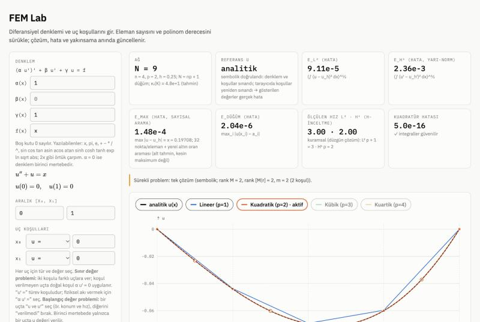
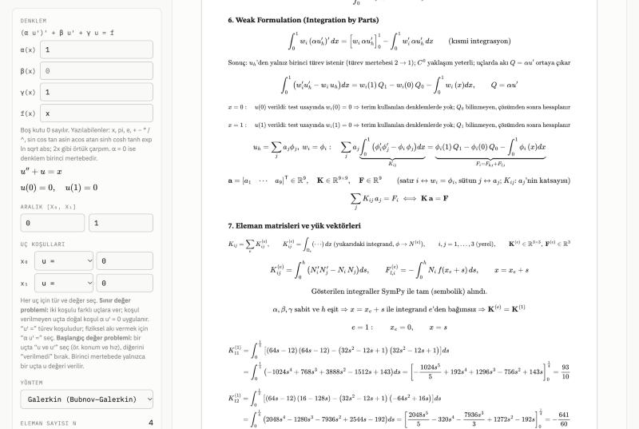
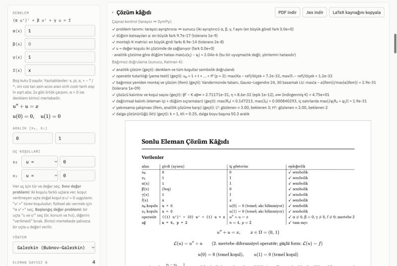
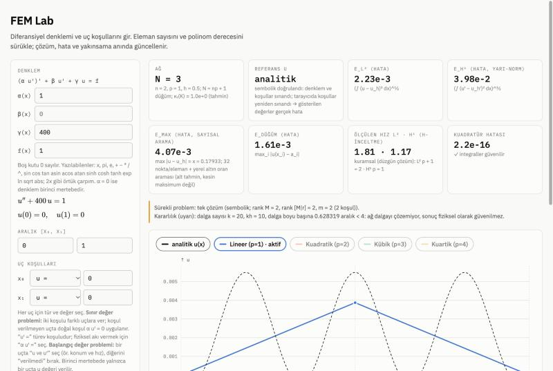
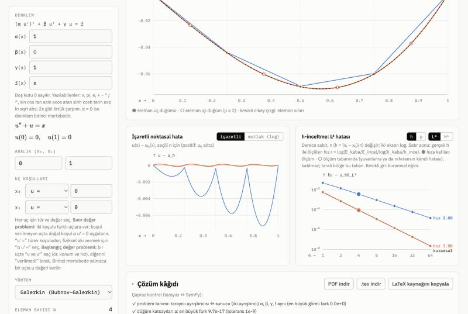

# FEM Lab

**A browser-based Galerkin finite element laboratory for one-dimensional linear differential equations — solve,
understand and verify.**

[](https://github.com/yzd-info/fem-lab/actions/workflows/ci.yml)
[](LICENSE)

FEM Lab solves a one-dimensional, linear, first- or second-order differential equation that you type in, using the
Galerkin finite element method. While you drag the number of elements and the polynomial degree, the solution, the
pointwise error and the convergence charts update instantly. On request it writes a step-by-step mathematical solution
sheet — shape functions, Galerkin equations, every element integral, assembly, boundary conditions, solution and error
— which you can download as PDF or LaTeX. Every result is checked by independent routes, and the checks are listed
next to the result.

FEM Lab is a **1D tool**. It is meant for learning and for checking hand calculations, not as a general-purpose FEM
package. The user interface is in Turkish.



## What you can do

| | |
|---|---|
| **Solve** | Enter $\alpha, \beta, \gamma, f$, the interval and the boundary conditions; choose $n = 1 \dots 64$ elements and Lagrange elements of degree $p = 1 \dots 4$; see $u_h$ for several degrees on top of each other. |
| **Understand** | Open the solution sheet: shape functions derived from polynomial interpolation, the Galerkin weighted residual, the weak form (second order only), every element integral, assembly, the reduced system and the reconstructed solution. Export as PDF or `.tex`. |
| **Verify** | Error in $L^2$, $H^1$, maximum and nodal norms; measured convergence rates under h- and p-refinement; analytical solutions that are validated against the equation and every boundary condition; an independent re-implementation; well-posedness and stability diagnostics. |

## How it works

1. **In the browser**, a numerical FEM kernel (JavaScript, 64-bit, Gauss quadrature) solves the problem on every
   change and draws the charts.
2. **On the local server**, a symbolic kernel (SymPy) solves the same problem exactly and writes the solution sheet.
   It runs as a five-layer pipeline: problem definition → problem validation → FEM engine → independent
   verification → sheet.
3. The two kernels are deliberately independent and are compared on every sheet (nodal values, assembled matrix,
   boundary values, parsed coefficients).
4. **Errors are measured against a reference.** If SymPy finds a closed-form solution that passes validation, it is the
   reference and the measures are true errors. Otherwise the reference is a fine-mesh solution of the same method
   ($n = 128$, $p = 4$); the measures are then *differences*, labelled as such, and they cannot reveal a systematic error
   of the method itself.

| Solution sheet | Verification results |
|---|---|
|  |  |

## Supported problems

```math
\big(\alpha(x)\,u'\big)' + \beta(x)\,u' + \gamma(x)\,u = f(x), \qquad x \in (x_0, x_1)
```

- One space dimension, linear, first or second order. $\alpha, \beta, \gamma, f$ are expressions in $x$ (polynomial,
  trigonometric, exponential, …). $\alpha \equiv 0$ gives a first-order equation.
- **Elements:** equally spaced Lagrange elements, P1 (linear), P2 (quadratic), P3 (cubic), P4 (quartic); $n = 1 \dots 64$
  equal elements; $N = np + 1$ nodes.
- **Boundary conditions** (per end point; $Q = \alpha u'$ is the flux):

  | UI label | Condition | Type |
  |---|---|---|
  | `u =` | $u(x_b) = g$ | essential |
  | `u′ =` | $u'(x_b) = g$ | derivative condition (natural; $Q = \alpha(x_b)\,g$) |
  | `α u′ =` | $\alpha(x_b)\,u'(x_b) = q$ | flux condition (natural; $Q = q$) |
  | `u ve u′` | $u$ and $u'$ at the same end | initial (or terminal) value problem |
  | `verilmedi` | none | natural condition $\alpha u' = 0$ (boundary value problem) or free end (initial value problem) |

  Derivative and flux conditions are different and are never converted into each other.
  **Robin conditions ($a\,u + b\,u' = c$) are not supported.**
- Second-order equations take two conditions at different ends, or $u$ and $u'$ at the same end. First-order
  equations take exactly one condition $u(x_b) = g$.

Formulations, the treatment of each boundary term, initial value problems and first-order compatibility are described
in [docs/MATEMATIK.md](docs/MATEMATIK.md).

## Quick start

**Requirements**

- To use the application: Python 3 and SymPy (installed from `requirements.txt`). Tested with Python 3.9 and
  Python 3.12. A browser with internet access is needed for MathJax, which is loaded from a CDN.
- Optional, for PDF export: `pdflatex` (for example TeX Live or MacTeX). Without it, "PDF indir" opens the browser's
  print dialog, where you can choose "Save as PDF".
- Only for the tests: Node.js (the test suite runs in CI with Node 22). The application itself does not need Node.

**Install and run**

```bash
git clone https://github.com/yzd-info/fem-lab.git
```

```bash
cd fem-lab
```

```bash
python3 -m pip install -r requirements.txt
```

```bash
python3 server.py
```

Open <http://localhost:8000>. The terminal shows `FEM Lab: http://localhost:8000`; keep it open (Ctrl+C stops the
server). On Windows, use `py` instead of `python3` if `python3` is not available.

Opening `index.html` directly (without the server) still gives the live charts, but not the solution sheet, the PDF
export or the analytical reference.

## Worked example

Solve $u' = 2x$ on $(0, 2)$ with $u(0) = 0$ (exact solution $u = x^2$):

| Field | Value |
|---|---|
| α(x) | *(empty)* |
| β(x) | `1` |
| γ(x) | *(empty)* |
| f(x) | `2x` |
| Interval | `0`, `2` |
| x₀ | `u =` `0` |
| x₁ | `verilmedi` |
| n, p | 2, 1 |

With linear elements the sheet derives $K^{(e)} = \begin{bmatrix} -\tfrac12 & \tfrac12 \\ -\tfrac12 & \tfrac12 \end{bmatrix}$
and $\mathbf{a} = [\,0,\ 2/3,\ 4\,]^{\mathsf T}$, i.e. $u_h = 2x/3$ on $[0, 1]$ and $u_h = 10x/3 - 8/3$ on $[1, 2]$
(continuous at the shared node: $u_h(1) = 2/3$), with a nodal error of $1/3$ (at $x = 1$),
$\|e\|_{L^2} = \sqrt{4/135} \approx 0.172133$ and $|e|_{H^1} = \sqrt{8/9} \approx 0.942809$. Moving the $p$ slider to 2 or 3
reproduces $x^2$ to machine precision.
Example sheets are in [`ornekler/`](ornekler/).

## Verification and testing

Each solution sheet ends with a list of checks, each marked passed, failed, warning or not performed:

- **analytical solution** — checked against the equation and every boundary condition before it is used; the evidence
  level (symbolic proof or 50-digit numerical check) is stated;
- **operator consistency** — a patch test comparing the assembled matrix with the user's operator applied directly;
- **independent re-assembly** — the same problem solved by a separate implementation in 30-digit arithmetic;
- **solver residual**, backward error and condition number;
- **classical vs distributional residual** for second-order problems;
- **convergence study** on three meshes, with the expected rate stated only where theory applies;
- **stability indicators** — element Péclet number and wave resolution ($kh$).

Well-posedness is reported separately for the **continuous** problem (rank analysis of the general solution) and the
**discrete** system (condition estimate, rank, left-null-space compatibility); a singular discrete system is never
presented as proof that the differential problem has no solution.



Run the tests:

```bash
node tests.js
```

```bash
python3 tests.py
```

```bash
python3 verification/run_verification.py --full
```

```bash
python3 -m pip install -r verification/requirements-verify.txt && python3 verification/run_corpus.py
```

`tests.js` checks the browser kernel (167 checks), `tests.py` the server pipeline and every sheet's LaTeX compilation
(221 checks; the LaTeX checks are skipped if `pdflatex` is missing), and `run_verification.py --full` the browser kernel
against an independent solver and analytical solutions. `run_corpus.py` runs 80 input-only cases through the server and
the browser kernel and cross-checks them with scikit-fem and a continuous-level analysis. GitHub Actions runs all four on
every pull request and every push to `main`, with Python 3.9 and 3.12.

Details, thresholds and their justification: [docs/DOGRULAMA.md](docs/DOGRULAMA.md).



## Architecture

| Component | Role |
|---|---|
| `index.html` | interface and numerical kernel (JavaScript, no dependencies) |
| `server.py` | local server (Python standard library): page, solution sheet, PDF |
| `fem_sheet.py` | problem definition, validation, symbolic FEM engine (SymPy), sheet formatting |
| `fem_verify.py` | independent verification (does not call the engine) |
| `verification/` | independent reference solver, benchmarks, regression baseline, 80-case input corpus with scikit-fem and continuous-level cross-verification |

There is no framework and no build step. The five-layer pipeline, the server endpoints and the interface are described
in [docs/MIMARI.md](docs/MIMARI.md).

## Limitations

- **Scope:** 1D, linear, first and second order only. Nonlinear, higher-order, systems of equations and time-dependent
  problems are not supported. No Robin conditions. Uniform meshes and $p \le 4$ only.
- **Fine-mesh reference:** without a validated analytical solution, errors are differences to a fine-mesh solution of
  the same method; they cannot reveal the method's own systematic error, and the reference's estimated error sets a
  measurement floor.
- **Convergence rates** are measured, not imposed. Optimal rates are expected only for smooth solutions of
  second-order boundary value problems with a non-vanishing $\alpha$; first-order and initial value problems have no such
  guarantee in this tool.
- **Initial value problems:** $u'(x_0)$ is satisfied only weakly, stability is conditional on the mesh, and phase error
  accumulates for oscillatory solutions on coarse meshes.
- **Stability:** standard Galerkin oscillates for convection-dominated problems on coarse meshes and gives no
  stability guarantee for first-order problems; the application warns but does not stabilise.
- **Degenerate or sign-changing $\alpha$:** reported as a warning; continuous classification is not attempted for interior
  zeros.
- **Numerical evidence:** maximum-norm errors are sampling-based lower bounds; integrals without a closed form are
  computed numerically and marked "≈"; diagnostic thresholds are heuristic.
- **Verification limits:** the independent re-assembly and the convergence study run only up to 129 unknowns; beyond
  that they are reported as not performed. Large sheets (for example $n = 40$, $p = 4$) take about 15–20 s.
- **Input:** scientific notation (`1e-8`) is rejected; write `10^-8`.

The complete list of qualifications is in [docs/MATEMATIK.md](docs/MATEMATIK.md) and [docs/DOGRULAMA.md](docs/DOGRULAMA.md).

## Status and roadmap

**Current release: v0.1.0** — everything described above is implemented and covered by the test suite.

Possible future directions (not scheduled, no release commitment):

- Robin boundary conditions;
- a stabilised method (for example SUPG) through the existing method interface, together with its solution sheet;
- degrees above 4, which would require Gauss–Lobatto nodes instead of equally spaced ones.

## Documentation

| Document | Contents |
|---|---|
| [docs/MATEMATIK.md](docs/MATEMATIK.md) | problem class, boundary conditions, Galerkin and weak formulations, initial value problems, first-order compatibility, residuals, solution-sheet structure |
| [docs/DOGRULAMA.md](docs/DOGRULAMA.md) | reference solutions, well-posedness diagnostics, analytical-solution validation, error measures, convergence interpretation, verification layer, tests |
| [docs/MIMARI.md](docs/MIMARI.md) | files, kernels, five-layer pipeline, server endpoints, interface, adding a method |
| [AUDIT_V0.1.md](AUDIT_V0.1.md), [PLAN_V0.1_DUZELTME.md](PLAN_V0.1_DUZELTME.md) | historical V0.1 audit and correction plan (Turkish; not updated after V0.1) |

## License

MIT — see [LICENSE](LICENSE).
